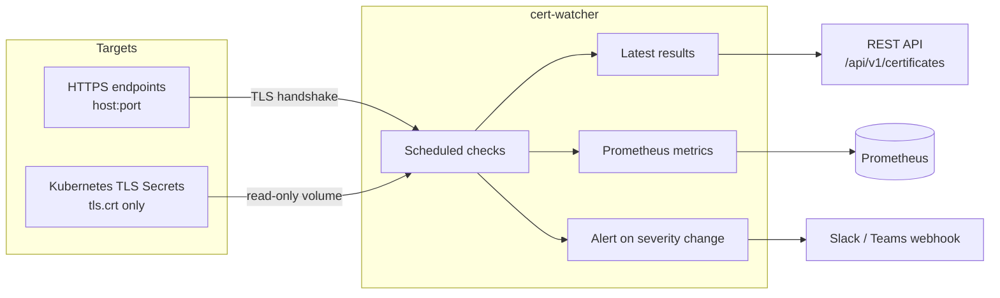

# cert-watcher

[](https://github.com/Hussain-MD/cert-watcher/actions/workflows/ci.yml)

Expired TLS certificates are one of the most common causes of avoidable outages. **cert-watcher** checks the
certificates on your HTTPS endpoints and in your Kubernetes TLS Secrets, exposes days-until-expiry as Prometheus
metrics, and posts an alert to Slack or Teams before anything expires.

It ships as a container image, a hardened Helm chart, an ArgoCD Application for GitOps, Terraform for AWS EKS,
and an Ansible role for plain Linux hosts.

## How it works



Each target is classified as `OK`, `WARNING` (within 30 days), `CRITICAL` (within 7 days), `EXPIRED`, or `ERROR`
(could not be checked). An alert is sent only when a target's severity changes, so a certificate in `WARNING`
does not page you every hour.

## Features

- **Two sources:** live TLS endpoints (with SNI) and PEM files such as mounted Kubernetes Secrets
- **Prometheus metrics:** `certwatcher_days_until_expiry{target="..."}` and `certwatcher_check_failures_total`
- **REST API** with OpenAPI docs at `/swagger-ui.html`; filter with `/api/v1/certificates?severity=WARNING`
- **Health probes** at `/actuator/health/liveness` and `/actuator/health/readiness`
- **Webhook alerts** compatible with Slack and Microsoft Teams incoming webhooks

## Quick start

Requirements: Java 17 and Gradle 8.10+ (or Docker).

```bash
gradle bootRun --args='--cert-watcher.endpoints=github.com,example.com:443 --cert-watcher.check-interval=PT1M'
curl -s localhost:8080/api/v1/certificates
```

With Docker:

```bash
docker build -t cert-watcher .
docker run -p 8080:8080 -e CERT_WATCHER_ENDPOINTS=github.com,example.com:443 cert-watcher
```

## Deploy to Kubernetes with Helm

```bash
helm install cert-watcher helm/cert-watcher \
  --set 'config.endpoints[0]=example.com:443' \
  --set 'certificateSecrets[0]=my-ingress-tls' \
  --set webhook.existingSecret=cert-watcher-webhook
```

The webhook Secret holds the URL under the key `url`:

```bash
kubectl create secret generic cert-watcher-webhook --from-literal=url='https://hooks.slack.com/services/...'
```

## Deploy with ArgoCD (GitOps)

[`deploy/argocd/cert-watcher.yaml`](deploy/argocd/cert-watcher.yaml) is an ArgoCD `Application` that tracks
`helm/cert-watcher` on `main`, creates the namespace, and keeps the cluster in sync (automated prune and self-heal):

```bash
kubectl apply -f deploy/argocd/cert-watcher.yaml
kubectl -n argocd get application cert-watcher
```

Change values in the manifest (or the chart) and push; ArgoCD rolls the change out without a manual `helm upgrade`.

## Provision AWS EKS with Terraform

[`terraform/aws-eks`](terraform/aws-eks) creates a VPC across three availability zones, an EKS cluster with a
managed node group, and installs ArgoCD with Helm, ready for the Application above.

```bash
cd terraform/aws-eks
terraform init
terraform apply -var kubernetes_version=<a version in EKS standard support>
$(terraform output -raw configure_kubectl)
kubectl apply -f ../../deploy/argocd/cert-watcher.yaml
```

> **Cost:** EKS, EC2 nodes and the NAT gateway are billed hourly. Run `terraform destroy` when you are done.

## Install on a Linux VM with Ansible

```bash
gradle bootJar
cd ansible
cp inventory.example.ini inventory.ini   # edit hosts
ansible-playbook -i inventory.ini playbook.yml \
  -e '{"cert_watcher_endpoints": ["example.com:443"]}'
```

The role installs Java 17, creates a system user, renders the config, and runs the service under a hardened
systemd unit. Keep `cert_watcher_webhook_url` in Ansible Vault.

## Configuration

| Property | Env variable | Default | Description |
|---|---|---|---|
| `cert-watcher.endpoints` | `CERT_WATCHER_ENDPOINTS` | none | Comma-separated `host` or `host:port` (default port 443) |
| `cert-watcher.certificate-files` | `CERT_WATCHER_CERTIFICATEFILES` | none | PEM files to check |
| `cert-watcher.check-interval` | `CERT_WATCHER_CHECKINTERVAL` | `PT1H` | ISO-8601 duration between runs |
| `cert-watcher.warning-days` | `CERT_WATCHER_WARNINGDAYS` | `30` | `WARNING` threshold |
| `cert-watcher.critical-days` | `CERT_WATCHER_CRITICALDAYS` | `7` | `CRITICAL` threshold |
| `cert-watcher.webhook-url` | `CERT_WATCHER_WEBHOOK_URL` | none | Slack/Teams webhook; alerts are logged when unset |

## Security design

- **Private keys never enter the pod.** The chart mounts only the `tls.crt` key of each Secret, read-only.
- **No Kubernetes API access.** The pod's service-account token is not mounted, so no RBAC is needed.
- **Hardened runtime:** non-root user (UID 10001), read-only root filesystem, all Linux capabilities dropped,
  `RuntimeDefault` seccomp profile, no privilege escalation.
- **Inspect-only TLS:** endpoint checks accept any certificate chain so expired or self-signed certificates can
  still be reported. Only the handshake runs; no application data is ever sent.
- **Supply chain:** every image is scanned with Trivy in CI, and Dependabot keeps Gradle, Docker and Actions
  dependencies current.

## CI pipeline

Every push and pull request runs on GitHub Actions:

1. **Build and test:** Gradle build, unit and web-layer tests, JaCoCo coverage report
2. **Helm:** `helm lint` and a template render with sample values
3. **Ansible:** `ansible-lint` on the playbook and role
4. **Terraform:** `terraform fmt -check` and `terraform validate`
5. **Image:** Docker build and Trivy scan; pushes to `ghcr.io` on `main`
6. **End to end:** spins up a kind cluster, installs the chart, creates a TLS Secret that expires in 20 days,
   and asserts the API reports it as `WARNING`
7. **GitOps (on `main`):** installs ArgoCD in a kind cluster, points an `Application` at the pushed commit, and
   waits for it to be `Synced` and `Healthy`

## Project layout

```text
src/main/java/.../check     certificate fetching, evaluation, metrics
src/main/java/.../alert     webhook notifier
src/main/java/.../api       REST controller
helm/cert-watcher           Helm chart
deploy/argocd               ArgoCD Application (GitOps)
terraform/aws-eks           Terraform for an EKS cluster with ArgoCD
ansible/                    playbook and cert_watcher role
.github/workflows/ci.yml    CI pipeline
```

## License

[MIT](LICENSE)
